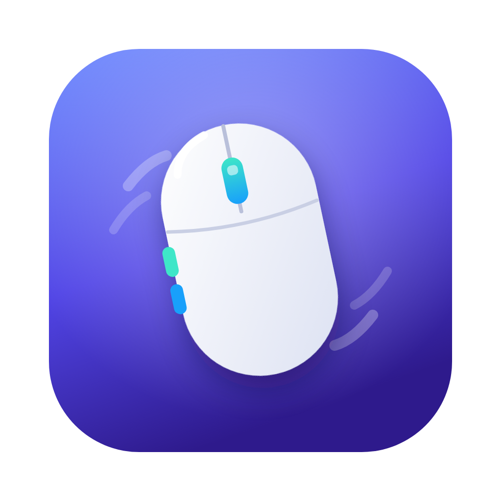

<div align="center">



# Mouse Fix Pro for Mac

**A free, open-source macOS mouse utility for button remapping, smooth scrolling, and pointer control.**
Assign Mission Control or shortcuts to extra buttons, tune scrolling, and disable pointer acceleration without changing your trackpad settings.

[](#install)
[](#install)
[](https://github.com/Anglersondev/Mouse-Fix-Pro-MAC/actions/workflows/build.yml)
[](#how-it-works)
[](#install)

[**⬇️ Download Mouse Fix Pro**](https://github.com/Anglersondev/Mouse-Fix-Pro-MAC/releases/latest) · [Features](#features) · [Comparison](#mouse-fix-pro-vs-mac-mouse-fix-3) · [FAQ](#faq) · [Português](README.pt-BR.md)

</div>

---

## What is Mouse Fix Pro?

**Mouse Fix Pro** is a **macOS 13+** utility for third-party USB and Bluetooth mice. It combines extra-button mapping, scrolling controls, pointer speed, and mouse gestures in one native Swift app. Compatibility depends on the signals a particular mouse exposes to macOS; proprietary buttons may require their manufacturer's software.

With it you can:

- **Remap supported mouse side buttons on Mac** to Mission Control, switch desktops (Spaces), go back and forward, control music, launch apps or trigger a keyboard shortcut.
- **Get smooth scrolling** on your mouse wheel, with the same feel as a trackpad.
- **Disable mouse acceleration on Mac** and pick a fixed pointer speed, ideal for gaming, design and video editing.
- **Keep your mouse speed** after locking the screen, waking from sleep or reconnecting Bluetooth. macOS tends to reset it on its own; Mouse Fix Pro re-applies your setting.
- **Use trackpad gestures with a mouse**: hold a button and drag to open Mission Control, show app windows or switch desktops.
- **Create per-app profiles**: the same button can do one thing in Safari and another in Photoshop, VS Code or Final Cut Pro.

It's free, open source and written in Swift.

## Release status and compatibility

| Item | Current status |
| --- | --- |
| Latest published version | [1.0.0](https://github.com/Anglersondev/Mouse-Fix-Pro-MAC/releases/tag/v1.0.0) |
| macOS | 13 Ventura or later |
| Mac hardware | Apple Silicon and Intel universal release |
| Distribution | ZIP containing the settings app and its background helper; ad-hoc signed |
| Permissions | Accessibility for mouse actions; Input Monitoring for buttons reported as keys |
| Device support | Standard mouse buttons and supported HID reports; check **What the mouse sends** for your device |
| Build status | [GitHub Actions build](https://github.com/Anglersondev/Mouse-Fix-Pro-MAC/actions/workflows/build.yml) |

The published ZIP is about **2.9 MB**. App size, memory use, and CPU use vary by build and Mac; no controlled performance comparison with other mouse utilities has been published.

## Support for buttons that send keyboard or media input

Many affordable Bluetooth mice, such as the **UGREEN 5-button vertical mouse**, send their side buttons as a **media key or keyboard shortcut** instead of a real mouse button. That's why, in other apps, those buttons only go back and forward and can't be set to Mission Control.

When the mouse exposes that signal through a supported HID interface, Mouse Fix Pro can identify its source, block the original action and run the one you picked. The **What the mouse sends** tab shows the signals the app can observe. Some proprietary buttons use a separate interface or protocol and may not be detectable or remappable in version 1.0.0.

## Features

| Area | What it does |
|---|---|
| 🖱️ **Buttons** | Click, double click, hold and hold + drag (↑ ↓ ← →) on any extra button, including the scroll wheel. Automatic detection: click *Detect button* and press it. |
| ⚡ **Actions** | Mission Control, App Exposé, Show Desktop, Launchpad/Apps, move one desktop left or right, back, forward, middle click, play/pause, next track, volume, mute, Look Up, screenshot, lock screen, new tab, close tab, reopen tab, zoom, custom keyboard shortcut and open any app. |
| 🎯 **Pointer** | Turn mouse acceleration off, set pointer speed from 0.25× to 4×, kept after lock, sleep and reconnect. |
| 📜 **Scrolling** | Smooth scrolling with natural acceleration, reverse scroll direction for the mouse only (the trackpad stays the same), scroll speed. |
| 🧩 **Per-app profiles** | Different button actions for each application. |
| 🔍 **Diagnostics** | Shows in real time what each mouse button sends. |
| ⚙️ **General** | Launch at login, optional menu bar and Dock icons, quick on/off switch. |
| 🌎 **Languages** | English and Portuguese. Follows your Mac's language or pick one in the General tab. |

## Mouse Fix Pro vs Mac Mouse Fix 3

Both apps improve third-party mice on macOS. This comparison is based on [Mouse Fix Pro's source](Sources/) and the [Mac Mouse Fix project's own documentation](https://github.com/noah-nuebling/mac-mouse-fix); it is a **feature and pricing comparison, not a speed or reliability benchmark**. Check current releases before choosing an app.

| Capability | Mouse Fix Pro 1.0.0 | Mac Mouse Fix 3 |
| --- | --- | --- |
| Price | Free | 30-day trial, then paid; Mac Mouse Fix 2 remains free |
| Smooth scrolling and button gestures | Yes | Yes |
| Per-app profiles | Yes, for button actions | Not available in version 3 according to its README |
| Pointer acceleration control inside the app | Yes | Not available; macOS 14+ can disable it in System Settings |
| Mouse buttons reported as keyboard/media input | Raw HID detection and diagnostics for supported devices; some buttons remain unsupported | Support varies by mouse; this specific path is not documented |
| Minimum macOS version stated by project | macOS 13 | macOS 11 for the latest version according to its README |

Mac Mouse Fix has a more mature gesture and scrolling experience, and may be the better fit for those priorities. Mouse Fix Pro is useful when you need free per-app button actions, in-app pointer controls, or diagnostics for an unusual side button. **Neither app guarantees that every proprietary mouse button will be recognized.** The projects are independent and unaffiliated.

## Background design

The **settings window quits completely** when you close it; the **Mouse Fix Pro Helper** stays running to handle mouse input. Its listeners are enabled only when their corresponding features need them:

- the keyboard listener only turns on if a mouse button arrives as a key;
- the motion listener only turns on while you hold a button that has a drag gesture;
- the smooth-scrolling animation only exists while a page is scrolling;
- pointer settings are applied through macOS HID interfaces rather than a continuous polling loop.

## Install

1. Download **MouseFixPro.zip** from the [releases page](https://github.com/Anglersondev/Mouse-Fix-Pro-MAC/releases/latest).
2. Unzip it and drag **Mouse Fix Pro** into your **Applications** folder.
3. The first time, right-click the app and choose **Open**. If macOS still blocks it, run this in Terminal:
   ```bash
   xattr -dr com.apple.quarantine "/Applications/Mouse Fix Pro.app"
   ```
4. Grant the permissions the app asks for in **System Settings › Privacy & Security**. They go to **Mouse Fix Pro Helper**, which is what reads the mouse:
   - **Accessibility**: to intercept clicks and run actions.
   - **Input Monitoring**: to read mice that send side buttons as keys.

Requires **macOS 13 Ventura or later** (Ventura, Sonoma, Sequoia and newer) on a Mac with **Apple Silicon (M1, M2, M3, M4...) or Intel**.

### Build from source

You need the Xcode command line tools (`xcode-select --install`).

```bash
git clone https://github.com/Anglersondev/Mouse-Fix-Pro-MAC.git
cd Mouse-Fix-Pro-MAC
./scripts/build-app.sh --install
```

Tip: ad-hoc signing changes with every build, so macOS forgets the permissions. Create a code signing certificate in Keychain Access and build with `SIGN_IDENTITY="Certificate name" ./scripts/build-app.sh --install`.

## FAQ

<details>
<summary><b>How do I remap mouse side buttons on a Mac?</b></summary>

Open Mouse Fix Pro, go to **Buttons**, click **Detect button** and press the side button. Then choose an action for *Click*, *Double click*, *Hold* or *Hold and drag*.
</details>

<details>
<summary><b>How do I open Mission Control with a mouse button?</b></summary>

In **Buttons**, pick **Mission Control** for the click of any button. To use it like a trackpad, open *Hold and drag* and click **Use Mission Control and desktop gestures**.
</details>

<details>
<summary><b>How do I turn off mouse acceleration on macOS?</b></summary>

In the **Pointer** tab, turn on *Adjust the pointer with Mouse Fix Pro* and turn off **Mouse acceleration**. The speed becomes linear and you set it with the *Speed* slider.
</details>

<details>
<summary><b>Why does my mouse speed change after I lock my Mac?</b></summary>

macOS re-applies default mouse values when the screen is unlocked, the Mac wakes up or a Bluetooth mouse reconnects. Mouse Fix Pro detects these moments and re-applies your setting automatically.
</details>

<details>
<summary><b>My mouse side buttons only go back and forward. Can I change that?</b></summary>

Sometimes. Open **What the mouse sends** and press the button. If a corresponding HID key or media signal appears, use **Detect button** and choose an action. If no signal appears, this version may not support that mouse's protocol or interface.
</details>

<details>
<summary><b>Why doesn't Detect button find one of my mouse buttons?</b></summary>

First confirm that **Mouse Fix Pro Helper** has Accessibility and Input Monitoring permissions, then reopen the app. In **What the mouse sends**, press the problem button and check whether a mouse click, HID key or media signal appears. A signal that only appears as a macOS event, or no signal at all, may be generated by a proprietary interface that version 1.0.0 cannot identify safely. Include the mouse model, USB/Bluetooth connection, macOS version and diagnostic lines in a [bug report](https://github.com/Anglersondev/Mouse-Fix-Pro-MAC/issues); redact any unrelated keyboard input before sharing the log.
</details>

<details>
<summary><b>How do I get smooth scrolling with a mouse on Mac?</b></summary>

In the **Scrolling** tab, turn on **Smooth scrolling**. You can also reverse the scroll direction for the mouse only, without changing the trackpad.
</details>

<details>
<summary><b>What runs in the background?</b></summary>

The settings app exits when you close its window. The helper remains to process configured mouse actions. The **General** tab reports its memory use. Measure CPU and memory on your own Mac if overhead is important; no cross-app benchmark has been published.
</details>

<details>
<summary><b>Is it safe? Why does it need Accessibility access?</b></summary>

macOS requires that permission for any app that reads clicks and sends shortcuts. Mouse Fix Pro has no network access, collects no data, and its code is open in this repository.
</details>

<details>
<summary><b>How is it different from Mac Mouse Fix?</b></summary>

See the [feature-by-feature comparison](#mouse-fix-pro-vs-mac-mouse-fix-3). Mouse Fix Pro is an independent project inspired by [Mac Mouse Fix](https://github.com/noah-nuebling/mac-mouse-fix) by Noah Nuebling and is not affiliated with it.
</details>

<details>
<summary><b>What languages does the app support?</b></summary>

English and Portuguese. By default the app follows your Mac's language; you can also pick one in the **General** tab.
</details>

## How it works

```
Mouse Fix Pro.app                      settings window (SwiftUI), quits completely
└── Contents/Library/LoginItems/
    └── Mouse Fix Pro Helper.app       does the work, no UI, always running

Sources/
├── MouseFixShared/      settings (JSON) and communication between the two processes
├── MouseFixProHelper/
│   └── Core/
│       ├── MouseCore.swift      wires everything; three event taps, each active only when needed
│       ├── HIDMonitor.swift     reads raw HID reports from mice on its own thread
│       ├── ButtonEngine.swift   click / double / hold / drag, per-app profiles
│       ├── PointerManager.swift speed and acceleration straight to the driver
│       ├── ScrollEngine.swift   smooth scrolling
│       ├── ActionRunner.swift   runs actions (synthetic events, Dock)
│       └── EventTap.swift       CGEventTap wrapper
└── MouseFixPro/         user interface
```

The two processes talk through macOS distributed notifications and share `~/Library/Application Support/MouseFixPro/config.json`. When a side button arrives as a key, `HIDMonitor` sees the report coming from the mouse and opens a short window in which the keyboard, media or gesture event generated by macOS is blocked. Real keyboard shortcuts keep working normally.

To inspect a mouse from Terminal without the app: `swift Tools/hidprobe.swift`.

---

## Support the project

Mouse Fix Pro is free and always will be. If it made your mouse better, you can [buy me a coffee ☕](https://pixgg.com/Anglerson).

## Author

Built by **Anglerson** · [anglerson.com.br](https://anglerson.com.br/) · [github.com/Anglersondev](https://github.com/Anglersondev)
