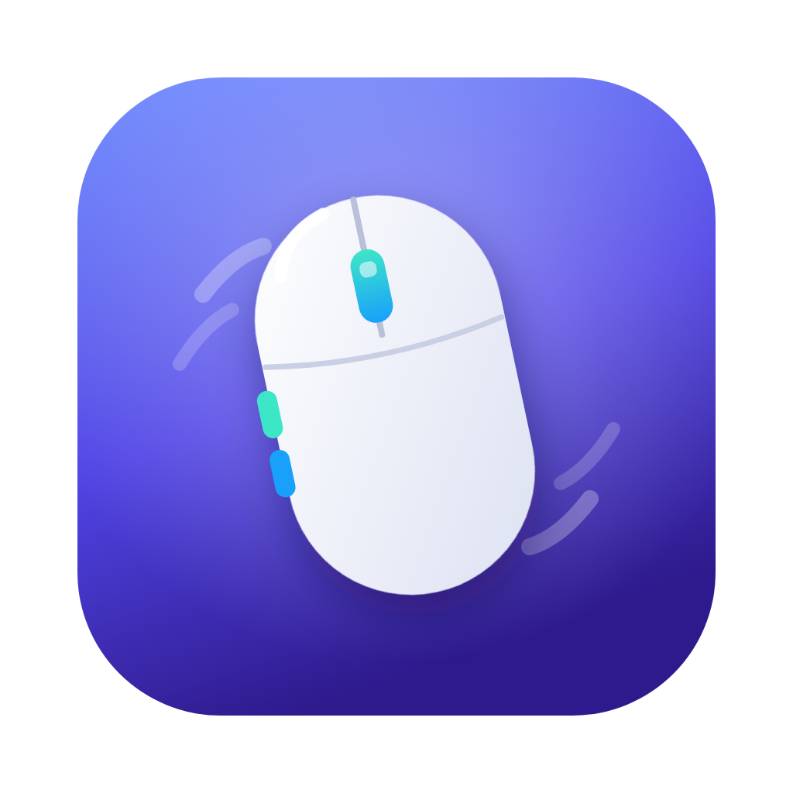

<div align="center">



# Mouse Fix Pro para Mac

**O app grátis e leve que deixa qualquer mouse perfeito no macOS.**
Configure os botões laterais, ligue a rolagem suave, desative a aceleração do mouse e abra o Mission Control com um clique.

[](#instalar)
[](#instalar)
[](#leve-de-verdade)
[](#como-funciona)
[](#instalar)

[**⬇️ Baixar o Mouse Fix Pro**](https://github.com/Anglersondev/Mouse-Fix-Pro-MAC/releases/latest) · [Recursos](#recursos) · [Perguntas frequentes](#perguntas-frequentes) · [English](README.md)

</div>

---

## O que é o Mouse Fix Pro?

O **Mouse Fix Pro** é um utilitário para **macOS** que faz mouses de outras marcas (Logitech, UGREEN, Razer, Microsoft, HP, Dell, Redragon, mouses verticais e genéricos USB ou Bluetooth) funcionarem tão bem no Mac quanto um trackpad da Apple.

Com ele você pode:

- **Configurar os botões laterais do mouse no Mac** para Mission Control, trocar de mesa, voltar e avançar, tocar música, abrir apps ou qualquer atalho de teclado.
- **Ter rolagem suave** na rodinha do mouse, com a mesma sensação do trackpad.
- **Desativar a aceleração do mouse no Mac** e escolher uma velocidade fixa, ideal para jogos, design e edição.
- **Manter a velocidade do mouse** depois de bloquear a tela, o Mac dormir ou o Bluetooth reconectar. O macOS costuma voltar ao padrão sozinho; o Mouse Fix Pro reaplica o seu ajuste.
- **Usar gestos de trackpad com o mouse**: segure um botão e arraste para abrir o Mission Control, ver as janelas do app ou trocar de mesa.
- **Criar perfis por app**: o mesmo botão faz uma coisa no Safari e outra no Photoshop, no VS Code ou no Final Cut.

É grátis, de código aberto e escrito do zero em Swift.

## Funciona até com mouse que "não deixa" configurar os botões laterais

Muitos mouses Bluetooth baratos, como o **UGREEN vertical de 5 botões**, mandam os botões laterais como **tecla de mídia ou atalho de teclado**, e não como botão de mouse. Por isso, em outros apps, os laterais só fazem voltar e avançar e não aceitam Mission Control.

O Mouse Fix Pro lê o sinal cru que sai do mouse (IOHID), percebe que veio do botão lateral, bloqueia a ação original e executa a que você escolheu. Na aba **"O que o mouse envia"** dá para ver ao vivo como cada botão chega ao Mac.

## Recursos

| Área | O que faz |
|---|---|
| 🖱️ **Botões** | Clique, clique duplo, segurar e segurar + arrastar (↑ ↓ ← →) em qualquer botão extra, inclusive a rodinha. Detecção automática: clique em *Detectar botão* e aperte. |
| ⚡ **Ações** | Mission Control, janelas do app, mostrar a mesa, Launchpad/Apps, mesa à esquerda e à direita, voltar, avançar, clique do meio, tocar/pausar, próxima faixa, volume, silenciar, pesquisar palavra, captura de tela, bloquear tela, nova aba, fechar aba, reabrir aba, zoom, atalho personalizado e abrir qualquer app. |
| 🎯 **Ponteiro** | Desligar a aceleração do mouse, velocidade de 0,25× a 4×, ajuste mantido após bloqueio, repouso e reconexão. |
| 📜 **Rolagem** | Rolagem suave com aceleração natural, direção invertida só no mouse (o trackpad continua igual), velocidade. |
| 🧩 **Perfis por app** | Botões diferentes para cada aplicativo. |
| 🔍 **Diagnóstico** | Mostra em tempo real o que cada botão do mouse envia. |
| ⚙️ **Geral** | Abrir ao ligar o Mac, ícone na barra de menus e no Dock opcionais, liga/desliga rápido. |
| 🌎 **Idiomas** | Português e inglês, seguindo o idioma do Mac. |

## Leve de verdade

| | Mouse Fix Pro | Mac Mouse Fix 3 |
|---|---|---|
| Tamanho do app | **menos de 1 MB** | cerca de 17 MB |
| Processo em segundo plano | Helper sem interface (sem SwiftUI) | Helper |
| Framework de atualização embutido | nenhum | Sparkle |
| Preço | grátis | pago após o período de teste |

Como no original, são dois processos: a **janela de ajustes fecha por completo** e só o **Mouse Fix Pro Helper** fica rodando. O Helper fica parado até você usar o mouse:

- o leitor de teclado só liga se algum botão do mouse chega como tecla;
- o leitor de movimento só liga enquanto você segura um botão com gesto de arrastar;
- a animação da rolagem suave só existe enquanto a página está rolando;
- velocidade e aceleração vão direto para o driver do mouse, sem gastar CPU.

## Instalar

1. Baixe o **MouseFixPro.zip** na [página de versões](https://github.com/Anglersondev/Mouse-Fix-Pro-MAC/releases/latest).
2. Descompacte e arraste o **Mouse Fix Pro** para a pasta **Aplicativos**.
3. Na primeira vez, clique com o botão direito no app e escolha **Abrir**. Se o macOS ainda bloquear, rode no Terminal:
   ```bash
   xattr -dr com.apple.quarantine "/Applications/Mouse Fix Pro.app"
   ```
4. Libere as permissões que o app mostrar em **Ajustes do Sistema › Privacidade e Segurança**. Elas vão para o **Mouse Fix Pro Helper**, que é quem lê o mouse:
   - **Acessibilidade**: para interceptar cliques e executar ações.
   - **Monitoramento de Entrada**: para ler mouses que mandam o botão lateral como tecla.

Requer **macOS 13 Ventura ou mais novo** (Ventura, Sonoma, Sequoia e posteriores), em Mac com **Apple Silicon (M1, M2, M3, M4...) ou Intel**.

### Compilar a partir do código

Precisa das ferramentas de linha de comando do Xcode (`xcode-select --install`).

```bash
git clone https://github.com/Anglersondev/Mouse-Fix-Pro-MAC.git
cd Mouse-Fix-Pro-MAC
./scripts/build-app.sh --install
```

Dica: a assinatura ad-hoc muda a cada build e o macOS esquece as permissões. Crie um certificado de assinatura de código no Acesso às Chaves e compile com `SIGN_IDENTITY="Nome do certificado" ./scripts/build-app.sh --install`.

## Perguntas frequentes

<details>
<summary><b>Como configurar os botões laterais do mouse no Mac?</b></summary>

Abra o Mouse Fix Pro, vá em **Botões**, clique em **Detectar botão** e aperte o botão lateral. Depois escolha a ação em *Clique*, *Clique duplo*, *Segurar* ou *Segurar e arrastar*.
</details>

<details>
<summary><b>Como abrir o Mission Control com o botão do mouse?</b></summary>

Em **Botões**, escolha **Mission Control** no clique do botão que quiser. Para usar como no trackpad, abra *Segurar e arrastar* e toque em **Usar gestos de Mission Control e mesas**.
</details>

<details>
<summary><b>Como desativar a aceleração do mouse no Mac?</b></summary>

Na aba **Ponteiro**, ligue *Ajustar o ponteiro pelo Mouse Fix Pro* e desligue **Aceleração do mouse**. A velocidade passa a ser fixa e você escolhe o valor no controle *Velocidade*.
</details>

<details>
<summary><b>Por que a velocidade do mouse muda sozinha depois de bloquear o Mac?</b></summary>

O macOS reaplica os valores padrão do mouse quando a tela é desbloqueada, o Mac acorda ou o mouse Bluetooth reconecta. O Mouse Fix Pro percebe esses momentos e reaplica o seu ajuste automaticamente.
</details>

<details>
<summary><b>Meu mouse só faz voltar e avançar nos botões laterais. Tem como mudar?</b></summary>

Sim. Esses mouses mandam os laterais como tecla de mídia ou atalho. O Mouse Fix Pro reconhece isso e deixa remapear normalmente. Veja na aba **"O que o mouse envia"** como o seu mouse se comporta.
</details>

<details>
<summary><b>Como deixar a rolagem do mouse suave no Mac?</b></summary>

Na aba **Rolagem**, ligue **Rolagem suave**. Também dá para inverter a direção só no mouse, sem mexer no trackpad.
</details>

<details>
<summary><b>O Mouse Fix Pro pesa no Mac?</b></summary>

Não. O app tem menos de 1 MB, a janela de ajustes sai da memória quando é fechada e o Helper fica parado até você usar o mouse. A aba **Geral** mostra quanto de memória ele está usando.
</details>

<details>
<summary><b>É seguro? Por que pede Acessibilidade?</b></summary>

O macOS exige essa permissão para qualquer app que lê cliques e executa atalhos. O Mouse Fix Pro não acessa a internet, não coleta dados e o código é aberto neste repositório.
</details>

<details>
<summary><b>Qual a diferença para o Mac Mouse Fix?</b></summary>

O Mouse Fix Pro foi inspirado no [Mac Mouse Fix](https://github.com/noah-nuebling/mac-mouse-fix), de Noah Nuebling, mas é um projeto independente, escrito do zero e sem ligação com o original. Ele adiciona suporte a mouses que mandam botões como tecla, perfis por app, controle de aceleração e velocidade do ponteiro, e é gratuito.
</details>

## Como funciona

```
Mouse Fix Pro.app                      janela de ajustes (SwiftUI), fecha por completo
└── Contents/Library/LoginItems/
    └── Mouse Fix Pro Helper.app       faz o trabalho, sem interface, sempre rodando

Sources/
├── MouseFixShared/      configuração (JSON) e comunicação entre os dois processos
├── MouseFixProHelper/
│   └── Core/
│       ├── MouseCore.swift      liga tudo; três event taps, cada um ativo só quando precisa
│       ├── HIDMonitor.swift     lê relatórios HID crus dos mouses numa thread própria
│       ├── ButtonEngine.swift   clique / duplo / segurar / arrastar, perfis por app
│       ├── PointerManager.swift velocidade e aceleração direto no driver
│       ├── ScrollEngine.swift   rolagem suave
│       ├── ActionRunner.swift   executa as ações (eventos sintéticos, Dock)
│       └── EventTap.swift       invólucro de CGEventTap
└── MouseFixPro/         interface
```

Os dois processos conversam por notificações distribuídas do macOS e dividem o mesmo `~/Library/Application Support/MouseFixPro/config.json`. Quando o botão lateral chega como tecla, o `HIDMonitor` vê o relatório vindo do mouse e abre uma janela curta em que o evento de teclado, mídia ou gesto gerado pelo macOS é bloqueado. O atalho real do teclado continua funcionando normalmente.

Para investigar um mouse pelo Terminal, sem o app: `swift Tools/hidprobe.swift`.

---

## Autor

Desenvolvido por **Anglerson** · [anglerson.com.br](https://anglerson.com.br/) · [github.com/Anglersondev](https://github.com/Anglersondev)

<sub>Palavras-chave: mouse para Mac, configurar botões do mouse no Mac, botões laterais mouse macOS, Mission Control no mouse, desativar aceleração do mouse Mac, velocidade do mouse Mac, rolagem suave mouse Mac, inverter rolagem só no mouse, alternativa ao Mac Mouse Fix, alternativa ao Logitech Options, mouse vertical Mac, mouse Bluetooth Mac, mouse fix pro.</sub>
